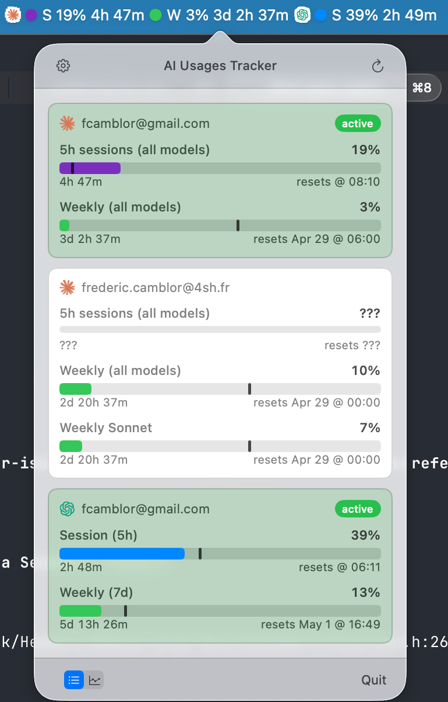
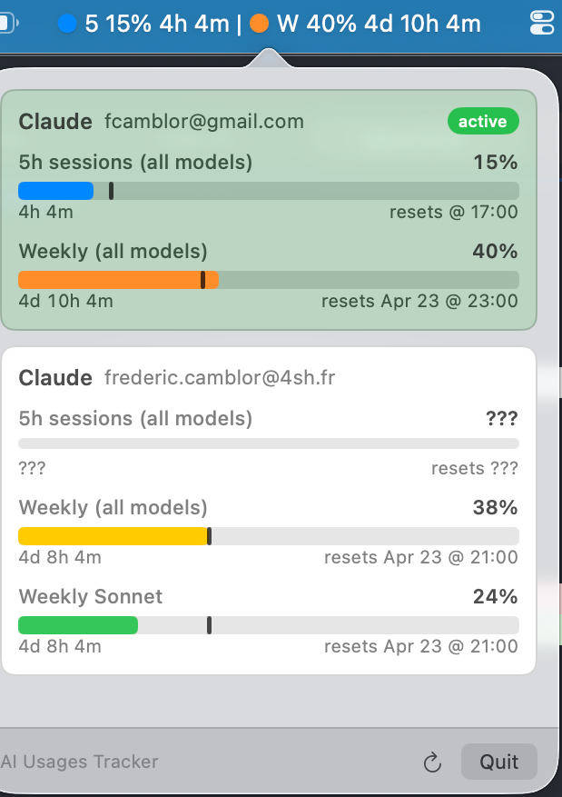
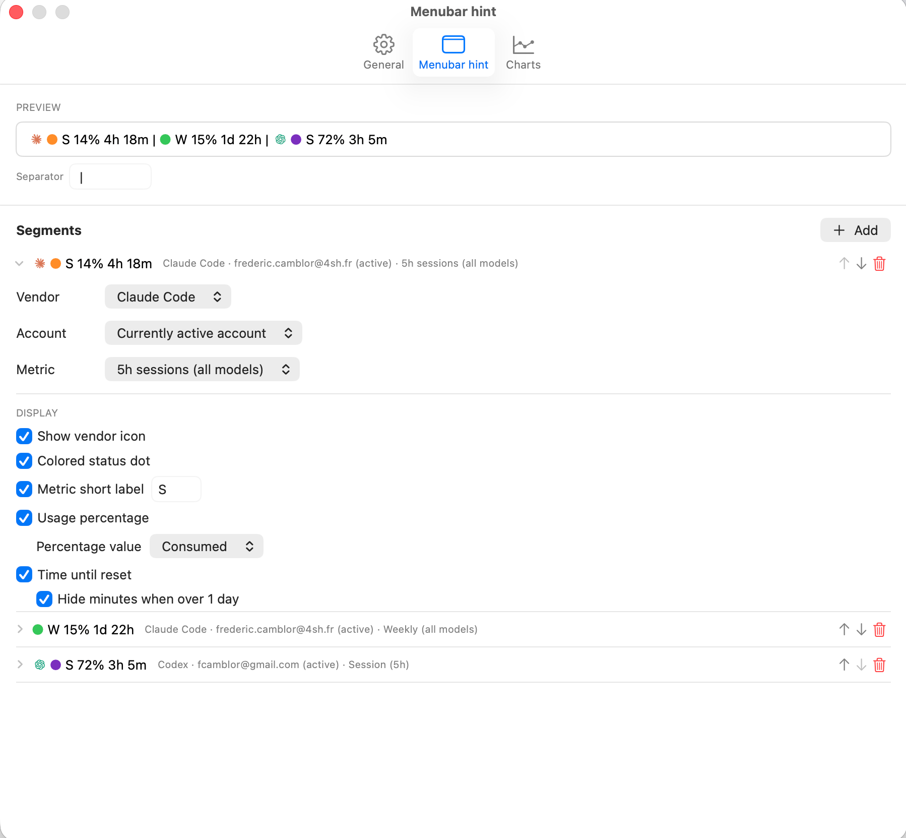
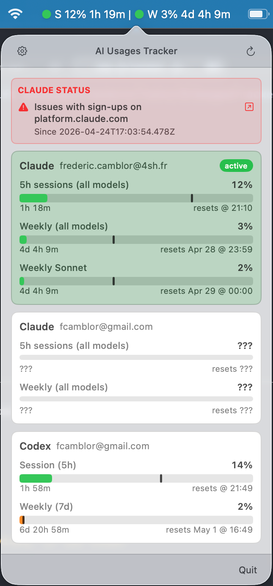
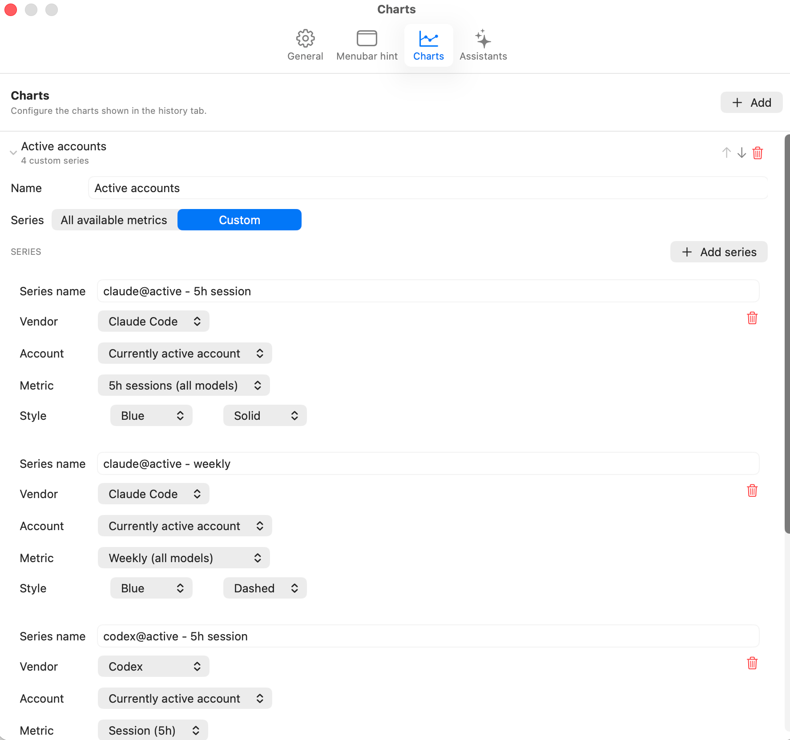
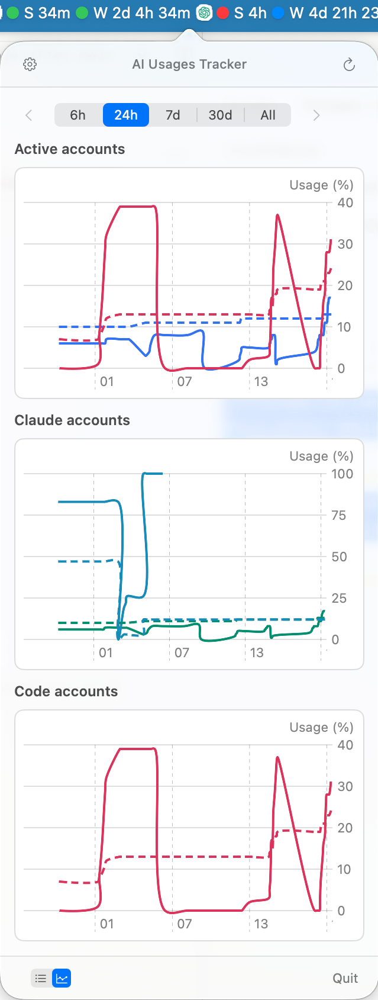

# AI Usages Tracker

AI Usages Tracker is a macOS menu bar app for monitoring AI assistant usage limits and account status. It keeps current usage visible at a glance, highlights the active local account, records usage history, and surfaces vendor status issues that may affect usage fetching.

The project aims to provide:

- Menu bar usage tracking for supported assistants.
- Active-account monitoring from each assistant's local configuration.
- Configurable usage history charts for recent consumption trends.
- Vendor status and outage visibility in the app popover.
- Configurable refresh behavior for automatic polling.

## Installation

Install with Homebrew:

```sh
brew tap fcamblor/tap
brew install --cask ai-usages-tracker
```

## First Launch

On a fresh install, the menu bar shows a **Configure AI Metrics** call to action — no segments are pre-seeded so the app does not assume which assistant or metrics matter to you.


Click the menu bar item to open the popover, then **Open Settings** to add your first segment (vendor, account, metric, display options). Once at least one segment is configured, the menu bar label switches to live usage data.

## Menu Bar Space and the Notch

On MacBooks with a notch, the usable menu bar width is split between the left side (occupied by app menus of the focused application) and the right side (occupied by status items). When the focused app exposes many menus, status items — including this tracker's label — can be hidden behind the notch, especially once several configurable segments are enabled.

This is a system-wide constraint rather than something the app can work around on its own. A robust workaround is to use [Ice](https://icemenubar.app/) ([source](https://github.com/jordanbaird/Ice)) by Jordan Baird, a free menu bar manager that hides, groups, and arranges status items so the tracker stays visible regardless of the focused app's menu width:

```sh
brew install --cask jordanbaird-ice
```

On macOS Tahoe, prefer the beta cask, which tracks the fixes required for that release:

```sh
brew install --cask jordanbaird-ice@beta
```

## Screenshots & Features

### Multi-account support

Monitor multiple AI assistant accounts side by side. The active account is highlighted so the currently billed usage is always visible at a glance. When the same Anthropic account is signed in to both the Claude TUI and Claude Desktop, the popover shows it as a single card with one chip per source.



### Color-coded usage gauges

Each usage bar changes color as consumption approaches the limit, making it easy to spot which metric needs attention without reading numbers.



### Customizable menu bar display

Configure which segments appear in the menu bar label — vendor icon, colored status dot, metric short label, usage percentage, and time until reset — and choose the separator between them. Each segment has its own display options: the usage percentage can show either consumed or remaining value, and the time-until-reset label can hide the minutes component when the remaining time exceeds one day.



### Vendor status alerts

When an assistant vendor reports an incident, a status banner appears at the top of the popover so usage anomalies can be attributed to known outages.



### Configurable chart panels

Configure charts from **Settings > Charts**: keep the default all-metrics panel, add multiple panels, or build custom series that target a vendor, the currently active account or a specific account, a metric, a color, and a line style.



### Usage history charts

Switch to the chart view to see consumption trends over the past 6 hours, 24 hours, 7 days, 30 days, or the full recorded history.

Hovering a chart shows the nearest values for each visible series. When a time-window metric expires before the next upstream reading, the history records that value as null so the chart breaks the line instead of drawing a misleading bridge across the reset.



## How It Works

### Non-intrusive by design

AI Usages Tracker never writes to, modifies, or migrates any AI assistant configuration. It reads credentials from the same local files and Keychain entries that each assistant already maintains; the assistant itself is unaware the tracker is running. Uninstalling the app leaves every assistant configuration exactly as it was.

### Account auto-discovery

No manual account setup is required. While the app runs, it periodically scans the credential sources defined for each supported vendor. Any account it finds is automatically surfaced in the popover and becomes available for menu bar segment configuration. Removing a credential from the source makes the account disappear on the next refresh.

### Multiple accounts per vendor

The tracker can display multiple accounts for the same vendor simultaneously. For vendors where only one account can be active at a time — such as the Claude TUI — the app highlights the active account so the currently billed usage is always clear at a glance.

The Claude TUI and Claude Desktop authenticate the same Anthropic accounts and report identical usage, so they are treated as one account family:

- An account seen by both sources is merged into a single card; per-source chips show which source is signed in and which Desktop profiles are running.
- The card's active highlight and every **Currently active** selection (menu bar chips, chart series) follow the Claude TUI account only. Several Claude Desktop profiles can run at once, so they never change which account is considered active.
- Menu bar and chart pickers expose a single **Claude** vendor covering both sources.
- Ignoring or reordering a merged account from Settings applies to all of its sources.

### Snapshot-based history

Usage data is never streamed live. The app takes periodic snapshots of the current usage figures and appends each changed snapshot to a daily log. Charts are rendered from that append-only history, so they reflect the shape of consumption over time rather than a single instant. Expired time-window metrics are preserved as null points, which lets charts show gaps when a metric is temporarily unavailable or has crossed a reset boundary.

### Configurable refresh interval

The polling frequency is adjustable in the app preferences. A shorter interval gives more granular snapshots at the cost of more API calls; a longer interval reduces traffic at the cost of coarser history. The value applies immediately without restarting the app.

### Menu bar segments from discovered accounts

Each entry that appears in the menu bar label is a configurable segment drawn from the auto-discovered accounts. The segment list is initialized on first launch and can be reordered or trimmed in the preferences panel at any time.

### Configurable chart panels

The history tab is driven by the chart list in **Settings > Charts**. A fresh install or existing profile without chart preferences is seeded with one "All available metrics" chart. Users can rename, reorder, delete, or add chart panels; custom panels can pin individual series to the currently active account or to a specific account.

## Supported Assistants

Each assistant entry below corresponds to a vendor-specific connector and a dated API snapshot under `docs/vendors/`. Adding or evolving a vendor goes through the workflow described in [`docs/ASSISTANT-ONBOARDING.md`](docs/ASSISTANT-ONBOARDING.md): a GitHub issue, a tester DMG built by CI, ≥ 2 distinct tester confirmations, and finally a tagged release that re-attaches the new entry to this section.

### Claude TUI

The Claude TUI is the `claude` command-line app (Claude Code CLI). AI Usages Tracker reads its active account from `~/.claude.json` and retrieves OAuth credentials from the macOS Keychain service `Claude Code-credentials`.

### Claude Desktop

Claude Desktop support is **off by default** and must be enabled in **Settings > Coding Assistants**. Turning it on makes the next refresh ask macOS for access to the `Claude Safe Storage` Keychain item; no Keychain prompt is raised before you opt in.

AI Usages Tracker reads the encrypted OAuth token cache stored in each Claude Desktop profile directory and decrypts it with the `Claude Safe Storage` key. Every existing profile directory is read:

- `~/Library/Application Support/Claude` (default profile)
- `~/Library/Application Support/Claude-3p` (secondary profile created by the installer)
- any custom folder added with **Add profile folder…** in **Settings > Coding Assistants**

The account email is resolved from Anthropic's profile endpoint so a Desktop profile matches the corresponding Claude TUI account. A profile is shown as running when a Claude Desktop process is open on its directory.

#### Running several Claude Desktop instances side by side

Claude Desktop normally runs a single instance tied to one account. Launching it with a dedicated `--user-data-dir` gives each instance its own profile directory, and therefore its own signed-in account:

```sh
open -n -a ~/Applications/Claude.app --args --user-data-dir="$HOME/Claude/Profiles/Perso"
```

`-n` forces a new instance even when Claude Desktop is already running. Adjust the app path to where Claude is installed (typically `/Applications/Claude.app`). Add each custom directory with **Add profile folder…** so the tracker picks up its usage.

See [`docs/vendors/claude-desktop.md`](docs/vendors/claude-desktop.md) for the full credential and API details.

### Codex

AI Usages Tracker reads Codex auth from the first available source:

- `CODEX_HOME/auth.json`
- `~/.config/codex/auth.json`
- `~/.codex/auth.json`
- macOS Keychain service `Codex Auth`

### GitHub Copilot CLI

AI Usages Tracker reads GitHub Copilot auth from the first available source:

- `GITHUB_TOKEN` environment variable
- macOS Keychain entry `gh:github.com` (written by the `gh` CLI)
- `gh` `hosts.yml`, searched as `$GH_CONFIG_DIR/hosts.yml`, then `$XDG_CONFIG_HOME/gh/hosts.yml`, then `~/.config/gh/hosts.yml`

The active GitHub login is read from `hosts.yml` (`github.com.user`).

## Data Locations

AI Usages Tracker keeps its runtime data under the current user's home directory.

### Cache and Logs

The app-owned cache directory is:

```text
~/.cache/ai-usages-tracker/
```

It contains:

- `usages.json`: latest usage snapshot used by the menu bar UI.
- `usages.json.lock`: advisory lock file used to coordinate safe reads and writes.
- `usage-history/YYYY/MM/YYYY-MM-DD.jsonl`: append-only daily usage-history snapshots, grouped by UTC date.
- `app.log`: app lifecycle, polling, persistence, and UI-adjacent logs.
- `claude-tui-usages-connector.log`: Claude TUI connector and status-fetch logs.
- `claude-desktop-usages-connector.log`: Claude Desktop connector logs.
- `codex-usages-connector.log`: Codex connector and status-fetch logs.
- `copilot-usages-connector.log`: GitHub Copilot CLI connector logs.
- `*.log.1`: rotated log backups. Each managed log rotates after 5 MB.
- `backuped-files/migration-to-0.8/`: snapshot of the preferences and cache files taken before the 0.7.x → 0.8 data migration. **Settings > Updates > Advanced** can restore it before downgrading to 0.7.x.

Deleting the cache directory resets local usage snapshots, history, and logs. It does not remove assistant credentials or macOS user preferences.

### User Preferences

Preferences are stored with macOS `UserDefaults.standard`. For the bundled app, the expected preferences file is:

```text
~/Library/Preferences/io.github.fcamblor.ai-usages-tracker.plist
```

The app stores these preference keys:

- `ai-tracker.refreshIntervalSeconds`: automatic refresh interval.
- `ai-tracker.launchAtLogin`: launch-at-login preference mirrored from the system login item state.
- `ai-tracker.logLevel`: selected log verbosity.
- `ai-tracker.menuBarChips`: configured menu bar chips and their segments.
- `ai-tracker.menuBarChipsInitialized`: internal flag that prevents reseeding chips after the user edits them.
- `ai-tracker.menuBarChipBackground`: colour scheme of the menu bar chip pills.
- `ai-tracker.chartConfigurations`: configured history chart panels and custom series.
- `ai-tracker.chartConfigurationsInitialized`: internal flag that prevents reseeding charts after the user edits them.
- `ai-tracker.ignoredAccounts`: accounts hidden from the popover.
- `ai-tracker.accountsOrder`: custom account order in the popover.
- `ai-tracker.updatesAutoCheckEnabled`, `ai-tracker.updatesDismissedVersions`: update-check preferences.
- `ai-tracker.statusComponentSubscriptions`: vendor status components the user subscribed to.
- `ai-tracker.claudeKeychainAccount`: Keychain entry pinned for Claude TUI credentials when several exist.
- `ai-tracker.claudeDesktopEnabled`: whether the Claude Desktop source is enabled.
- `ai-tracker.claudeDesktopProfilePaths`: custom Claude Desktop profile folders.
- `ai-tracker.storageSchemaVersion`: version of the stored preferences layout, used to migrate settings from older releases.
- `ai-tracker.pendingUpgradeChangelog`: internal flag that shows the "What's new" window once after such a migration.

Other `ai-tracker.*Migration*` keys are internal one-shot migration markers.

Assistant OAuth credentials are not stored in this preferences file. They are read from the assistant-specific files and Keychain services listed above.

## Color Display

Colors are used as status signals, not as persisted data. They are computed at render time from usage metrics, vendor branding, or incident severity.

### Usage Severity Colors

Time-window metrics are compared against their theoretical pace for the current window:

```text
consumption ratio = actual usage percent / expected usage percent at this point in the window
```

That ratio drives the colored status dot in the menu bar and the gauge fill color in the popover:

| Tier | Ratio | Color |
| --- | ---: | --- |
| Comfortable | `< 0.7` | system green |
| On track | `0.7 - 0.9` | system blue |
| Approaching | `0.9 - 1.0` | system yellow |
| Over pace | `1.0 - 1.2` | system orange |
| Critical | `1.2 - 1.6` | system red |
| Exhausted | `>= 1.6` | purple `#7B2FBE` |

Pay-as-you-go metrics, such as Codex credits, render as plain text without a severity dot.

## Build From Source

Requirements:

- macOS 14 or later.
- Swift 6 toolchain or Xcode command line tools.
- Homebrew, if installing the distributed cask.

Build and launch the app bundle from the repository root:

```sh
./scripts/build-app-bundle.sh
open "dist/AI Usages Tracker.app"
```

## Development

Run development commands from `AIUsagesTrackers/`, the Swift package root:

```sh
swift build
swift run AIUsagesTrackers
swift test
swift package clean
```

Additional project notes:

- [Development guide](docs/DEVELOPMENT.md)
- [Architecture overview](docs/ARCHITECTURE.md)
